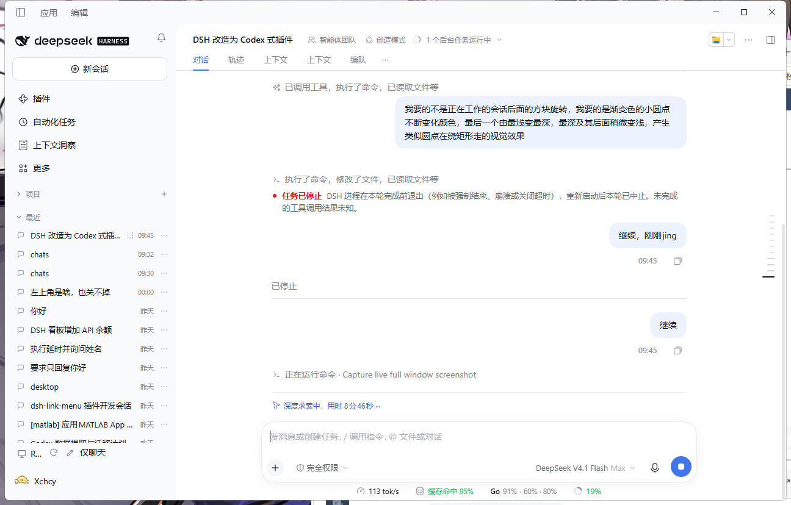
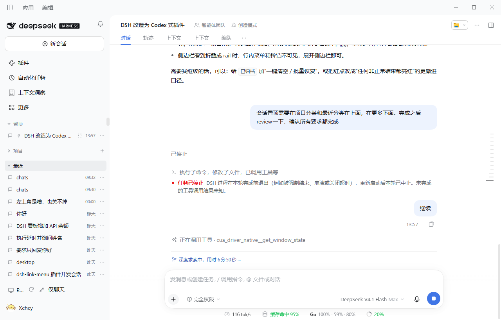
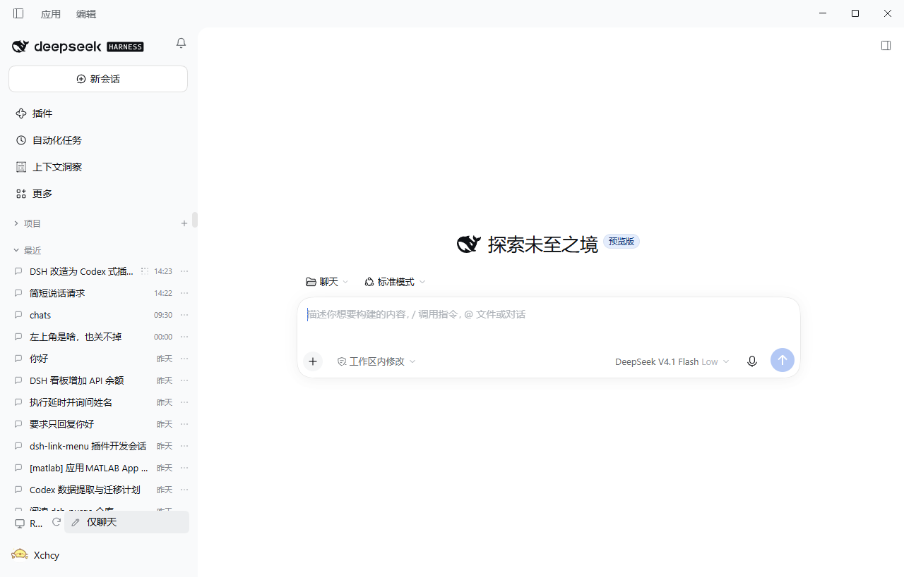
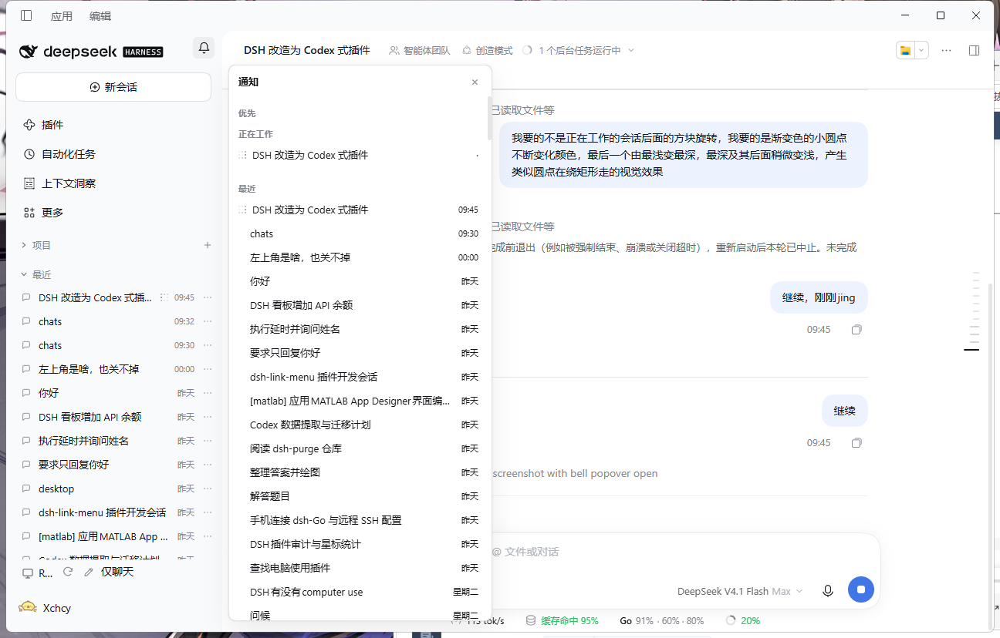
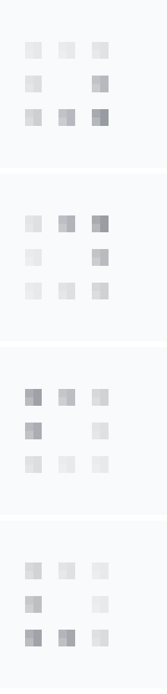
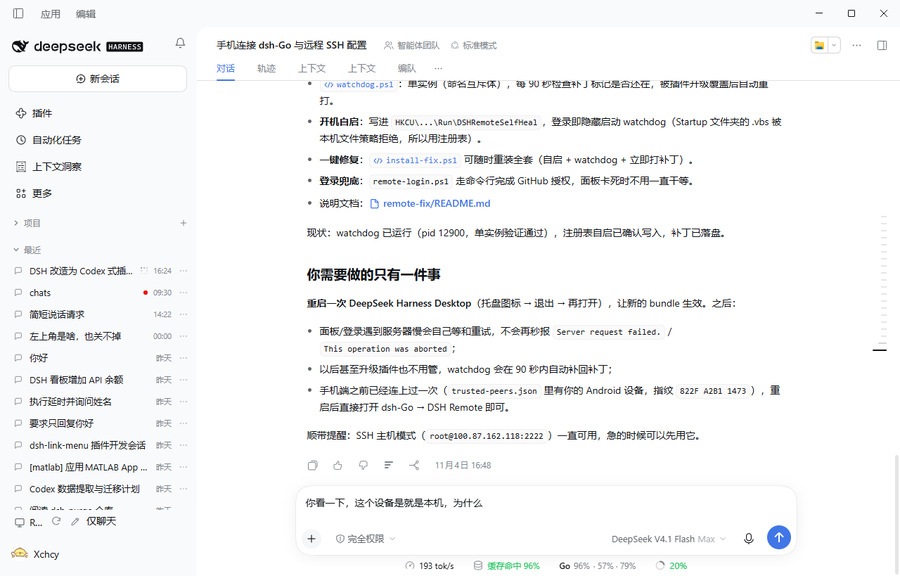

# DSH Codex 风格插件集

三个**互相独立、可单独安装/卸载**的 [DeepSeek Harness](https://github.com/deepseek-ai) 客户端插件，把 DSH 的侧边栏、会话浏览与通知改造成更接近 Codex 的工作流。

在 DSH 0.2.1-rc.5（Electron 44 / Windows）上开发并实测。

| 插件 | 目录 | 作用 |
| --- | --- | --- |
| 仅聊天模式 | `chat-only/` | 侧边栏底部新增「✏️ 仅聊天」按钮，一键在 `~/.dsh/chats`（「聊天」工作区）打开空白会话，不依附任何项目。 |
| 项目 / 最近 浏览器 | `projects-browser/` | 替换原生侧边栏工作区区：固定在顶部的「置顶」「项目」「最近」三个分区；分区标题与工作区行支持右键菜单（添加 / 重命名 / 删除工作区、会话排序、折叠、显示或隐藏置顶分区）；每行右侧 `⋯` 菜单支持置顶 / 取消置顶 / 归档。 |
| 通知铃铛 | `notifications-bell/` | 侧边栏右上角铃铛：等待审批 = 黄点，意外停止 = 红点，已完成 = 蓝点；点开按「正在工作 → 等待审批 → 意外停止 → 已完成」优先显示，下方是最近的会话。 |

## 预览

| 侧边栏 | 置顶分区 | 置顶 / 归档菜单 |
| --- | --- | --- |
|  |  |  |

| 铃铛面板 | 「正在工作」小点动画（4 帧） |
| --- | --- |
|  |  |

| 意外停止（红点，非主动停止） |
| --- |
|  |

## 安装

每个插件都是标准的 DSH bundle（`package.json` + `cordis.patch.yml` + `index.js` + `client.js` + `locale/` + `icon.svg`），可以只装一个，也可以三个都装。下面三种方式任选一种。

### 方式一（推荐）：让 DSH 里的 AI 帮你装

不需要记任何命令。打开 DSH，新建一个会话，把下面整段话复制发给它：

```text
帮我安装 DeepSeek Harness 插件，仓库地址：https://github.com/Xchcy/dsh-codex-kit

请按顺序完成：
1. 检查本机有没有 git；没有就告诉我，不要擅自安装系统软件。
2. 把仓库克隆到固定目录（例如 ~/Documents/dsh-plugins/dsh-codex-kit）；目录已存在就先 git pull 更新。
3. 用 plugin_manager 工具安装插件，每个目录一次，target 用克隆后的绝对路径：
   - <克隆目录>/projects-browser
   - <克隆目录>/notifications-bell
   - <克隆目录>/chat-only
   如果我说了只要其中某几个，就只装那几个。
4. 装完告诉我：装了哪几个、是否已启用、需不需要刷新页面或重启 DSH。
   如果需要重启，先征求我同意，不要直接结束 DSH 进程。
```

几个小提示：

- 提示词里特意写了「不要直接结束 DSH 进程」：DSH 被强行结束时，正在进行的对话会被标记为「任务已停止 / 意外停止」，红点就是这么来的。
- 如果你的 DSH 开着「需要审批」，AI 执行命令和安装前会弹确认，点允许即可。
- DSH 版本建议 0.2.1-rc.5 及以上（本插件在该版本实测）。

**装完怎么确认**：刷新一次页面（`Ctrl+Shift+R`）后，侧边栏底部出现「✏️ 仅聊天」、右上角出现铃铛、侧边栏只剩「项目」「最近」（有置顶会话时多一个「置顶」），就说明装好了。若没有，让 AI 执行 `plugin_manager action=list_plugins`，确认列表里出现 `include:@local/dsh-...` 三个条目。

### 方式二：手动安装

先克隆仓库：

```bash
git clone https://github.com/Xchcy/dsh-codex-kit.git
```

然后在 DSH 会话里让 AI 执行（把 `<repo>` 换成克隆后的绝对路径）：

```
plugin_manager action=install_bundle target="<repo>/projects-browser"
plugin_manager action=install_bundle target="<repo>/notifications-bell"
plugin_manager action=install_bundle target="<repo>/chat-only"
```

插件会以 `link:` 方式登记到当前 profile（`~/.dsh/profiles/<profile>`）。新装插件立即生效；**更新**已注册插件的代码后需要刷新页面（DevTools 打开后 `Ctrl+Shift+R`）才会换成新版本。

### 方式三：从插件市场安装

本仓库已按 [awesome-dsh-plugin](https://github.com/awesome-dsh-plugin/awesome-dsh-plugin) 的收录格式提交条目（`data/plugins/Xchcy__dsh-codex-kit--*.yml`）。收录合并后，可在 DSH 的 **插件 → Discover** 里搜索 `dsh-codex-kit` 安装；也可以把该市场的 index 地址加到 Discover 的「索引源」：

```
https://awesome-dsh-plugin.com/index.json
```


### 更新与卸载

- 更新：进入克隆目录执行 `git pull`，再刷新页面；或者让 AI 对同一路径再执行一次 `install_bundle`。
- 禁用 / 卸载：

```
plugin_manager action=list_plugins                       # 找到 include:@local/dsh-xxx
plugin_manager action=set_plugin target=include:@local/dsh-xxx enabled=false
plugin_manager action=remove_bundle target="@local/dsh-xxx"
```

### 常见问题

- **刷新页面后提示「DeepSeek Harness 无法使用」**：这是开发态 bundle 版本对不上导致的启动失败，点弹窗里的「重启」即可恢复；不要手动结束进程。
- **侧边栏的「插件 / 自动化任务 / 上下文洞察 / 更多」不见了**：这是 projects-browser 的预期行为——它把侧边栏精简成「项目 + 最近（+ 置顶）」。
- **「仅聊天」按钮点了没反应**：确认 `~/.dsh/chats` 目录存在（插件会在 DSH 启动时自动创建）；仍不行就看 AI 会话里 `plugin_manager` 的报错。
- **铃铛不见了**：侧边栏被折叠成窄条（rail）时铃铛会隐藏，展开侧边栏即可。
- **想要「已归档」**：右键「最近」标题 →「显示已归档会话」，列表底部会出现已归档分区，行末可恢复。

## 功能细节

### chat-only

- 「✏️ 仅聊天」位于侧边栏底部（原生 `sidebar.footer.action` 插槽），点击后打开「聊天」工作区的空白会话，输入框立即可用。
- 「聊天」工作区固定为 `~/.dsh/chats`，由插件的 host 半边在 DSH 启动时 `mkdir -p` 创建（DSH 的 `workspaces.create` 要求目录已存在）。
- 聊天会话仍然是普通 DSH 会话，只是不属于任何项目：在「项目」中隐藏，只出现在「最近」和铃铛里。

### projects-browser

用自定义实现替换原生 `sidebar.workspaces`（`priority: -10` shadow），从上到下依次是：

1. **置顶**：已置顶的会话单独成区，排在「项目」「最近」之上，按当前排序规则排列；没有置顶会话（或在右键菜单里隐藏了该分区）时整区不显示。
2. **项目**：按工作区列出，可展开显示工作区内会话；标题右侧 `+` 可添加工作区。折叠状态记在 `localStorage["dsh.projectsBrowser.projects"]`。
3. **最近**：聊天会话 + 各工作区会话合并成的扁平列表，按优先级排序（见下表）。新建但从未发过消息的空会话不会出现在任何列表里。

侧边栏里的「插件 / 自动化任务 / 上下文洞察 / 更多」等原生入口会被隐藏，只保留「项目」「最近」（以及有内容时的「置顶」）。「已归档」默认不在侧边栏显示：在「最近」标题上右键 →「显示已归档会话」，列表底部会出现「已归档」分区，点行末的恢复按钮即可把会话放回「最近」；再右键可以隐藏该分区。

**固定在顶部**

「置顶」「项目」「最近」的分区标题使用 `position: sticky`，滚动列表时始终贴在侧边栏顶部，并带底部分隔线。

**右键菜单**

- 「项目」分区标题右键：`添加工作区` / 排序方式 / `折叠`–`展开`。
- 「最近」分区标题右键：排序方式（按最近活跃时间 / 按创建时间 / 按名称） / `显示已归档会话` – `隐藏已归档会话`。
- 「置顶」分区标题右键：排序方式 / `显示置顶分区`–`隐藏置顶分区`。
- 工作区行右键：`重命名`（弹出输入框，确认后改名）/ `删除`（二次确认；只从侧边栏移除登记，文件夹与会话记录都会保留）。

排序方式与置顶分区显隐分别保存在 `localStorage["dsh.projectsBrowser.sort"]` 和 `localStorage["dsh.projectsBrowser.pinnedHidden"]`，刷新后保持。

每行右侧 `⋯` 菜单：`置顶会话` / `取消置顶` / `归档会话`；归档行（通过恢复入口打开）只有 `恢复会话`。归档正在运行的会话会先弹出确认，确认后先停止再归档。

**「最近」的排序规则**

| 优先级 | 状态 | 行首标记 |
| --- | --- | --- |
| 1 | 正在工作（running） | 灰色方框 8 个小圆点，亮点沿方框循环、带渐隐拖尾（CSS 动画，无 JS 计时器） |
| 2 | 等待审批 / 等待回答 / 等待确认计划 | 黄点 |
| 3 | 意外停止（非用户主动停止） | 红点 |
| 4 | 已完成（有未读完成提示） | 蓝点 |
| 5 | 普通会话 | 无 |

同一优先级内按最后活动时间从新到旧；已置顶的会话不在「最近」中重复出现。

**「意外停止」如何判定**

- 页面运行期间：宿主发出 `api-session/error` 事件时，该会话标红；重新运行或打开会话后清除。
- 进程被强制结束 / 崩溃 / 关闭超时：这类情况宿主不会发出事件，但客户端会把「自己看到过正在运行、却始终没有看到结束」的会话记到 `localStorage["dsh.projectsBrowser.interruptedTurns"]`。下次 DSH 启动时这些会话显示红点（即「任务已停止」的那一轮），打开会话或重新运行后清除，超过 30 天的记录自动清理。

### notifications-bell

- 铃铛固定在侧边栏右上角（`shell.overlay` 插槽，不依赖原生侧边栏内部结构）。颜色点表示当前最高优先级：黄（有等待审批）> 红（有意外停止）> 蓝（有已完成）。
- 点开后是通知面板：「优先」区只显示状态摘要（`正在工作 N` / `等待审批 N` / `意外停止 N` / `已完成 N`）。某个状态**只有一条会话**时，点状态行直接打开那条会话；有多条时打开右侧「会话看板」并只显示该状态。「查看详情」打开完整看板，看板里的每一行都能点开对应会话。
- 「会话看板」是右侧浮层，按状态分组列出会话，可点 `全部` 查看所有状态，点 `×` 关闭；打开会话时看板会自动收起。
- 「最近」区为按优先级排序的会话，右侧显示「今天 HH:MM / 昨天 / 星期几 / 年月日」。
- 点击任一会话直接打开；点击面板/看板以外的位置或按 `Esc` 关闭。
- 与 projects-browser 使用同一套状态判定规则；两者可以同时安装，也可以只装一个。

## 已知限制

- 三个插件都依赖 DSH 当前的客户端插槽与 API（`sidebar.footer.action`、`sidebar.workspaces`、`shell.overlay`、`uiWorkspace`、`useSessions` / `useSessionStatus` / `useWorkspaces`）；DSH 升级后若这些接口变化需要跟进。
- 「意外停止」不能回溯历史：只对当前页面期内发生的事件，或上一次运行留下的「正在运行」记录生效；更早的错误不会显示。
- 空白会话（新建后未发送任何消息）：当前 DSH 没有删除会话的 RPC，插件只能把它们从所有列表和铃铛中隐藏；DSH 新建会话时会复用空白会话，因此不会无限堆积。
- 侧边栏窄到折叠为 rail 时，行内菜单与铃铛不可见，展开侧边栏即可。
- 状态与排序来自客户端实时数据，刷新页面后才会重新计算「意外停止」的红点记录。

## 目录结构

```
chat-only/            # 插件 1：仅聊天按钮
  client.js           # 浏览器端：注册 sidebar.footer.action
  index.js            # host 端：启动时创建 ~/.dsh/chats
  package.json        # @local/dsh-chat-only
  cordis.patch.yml    # 插件条目声明
  locale/{zh,en}.json
  icon.svg
projects-browser/     # 插件 2：项目 / 最近 / 置顶 / 已归档
  client.js           # shadow sidebar.workspaces，自绘分区与行菜单
  ...
notifications-bell/   # 插件 3：铃铛与通知面板
  client.js           # shell.overlay 注册浮层
  ...
screenshots/          # 实机截图
```

## 开发说明

`client.js` 由 DSH 的客户端模块加载器装载：

```js
window.__ModuleLoader__.load({
  id: '@local/dsh-projects-browser',
  factory(require) {
    // ...
    return {
      inject: ['slots', 'locale', 'sessions', 'workspaces', 'uiWorkspace', 'remote'],
      apply(ctx) {
        ctx.effect(() => ctx.slots.register({ /* slot, id, order, priority */ }, () => {
          /* component */
        }), 'entry-id');
      },
    };
  },
});
```

- **插槽规则**：single 插槽（如 `sidebar.workspaces`）若要替换原生内容，必须以不同 `priority` 注册（如 `-10`，最低者生效）；想要在插件内部绘制子插槽，必须在注册时声明 `children`，但已声明的子名不能重复声明。
- **root props**：`renderSlot` 会向 entry 注入 root 级 hooks —— `useSessions`、`useSessionStatus`、`useWorkspaces`、`usePanelInfo`、`t` 等；插件自己的 `inject` 值也会作为 props 传入。
- **样式**：全部为插件自带的 `dsh-pb-*` / `dsh-nb-*` 类名 + DSH 的 `--dsw-alias-*` CSS 变量，不侵入宿主样式。
- **本地化**：`ctx.locale.register(namespace, { zh, en })`，界面文案走 `t('key')`。
- 修改 `client.js` 后刷新页面；若开发服务器残留旧 bundle，可重启 DSH 应用。

## License

MIT
